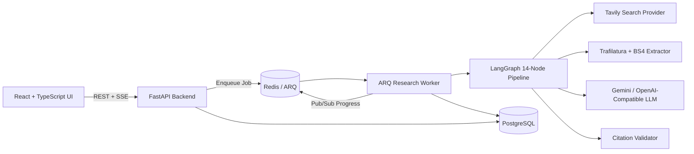

# Vellum Research

An open-source AI research workspace that turns complex questions into structured, evidence-backed reports with traceable sources.

Vellum Research acts like a methodical research analyst rather than a generic chatbot: it decomposes questions into focused subquestions, executes multi-angle web discovery, extracts readable webpage content, evaluates provenance and limitations, cross-checks conflicting claims, validates every inline citation against collected sources, and exports clean Markdown and PDF reports.

---

## Key Features (Version 1)

- **Controlled LangGraph Research Workflow**: Deterministic 14-stage pipeline (`understand_question` → `create_research_plan` → `generate_search_queries` → `search_web` → `deduplicate_sources` → `rank_sources` → `extract_source_content` → `extract_evidence` → `evaluate_evidence` → `cross_check_claims` → `identify_research_gaps` → `generate_report` → `validate_citations` → `save_research_results`) with strict retry caps and graceful cancellation.
- **Pluggable Search & LLM Providers**:
  - Web Search: `TavilySearchProvider` (live web discovery) + `MockSearchProvider` (clearly labeled demo/test mode).
  - LLMs: `GeminiProvider`, `OpenAICompatibleProvider`, and `MockLLMProvider`.
- **Two-Stage Search & Safe Extraction**: Deduplicates canonical URLs, enforces domain diversity, and extracts clean text with `Trafilatura` and `BeautifulSoup4`.
- **Transparent Evidence & Contradiction Analysis**: Distinguishes verified facts, source-reported claims, interpretations, and unverified findings; classifies cross-source disagreements (`genuine_contradiction`, `difference_in_measurement`, `difference_in_scope`, `difference_in_date`, `incomplete_evidence`).
- **Deterministic Citation Validation**: Verifies every inline `[n]` citation maps to a real collected source in the current run and prevents ungrounded URLs.
- **Interactive Research Workspace**:
  - Real-time SSE progress stream and subquestion tracker
  - Flagship Report Reader with sticky Table of Contents, clickable inline `[n]` citation inspector, Recharts evidence analytics, follow-up Q&A, and Markdown/PDF exports
  - Filterable Source Library with publisher, date, extraction status, limitations, and excerpts
- **Security-First Design**: SSRF protection blocking localhost/private IPs/metadata endpoints/unsafe redirects, untrusted webpage content isolation, JWT authentication, per-user ownership isolation, and rate limiting.

---

## Architecture



---

## Tech Stack

- **Frontend**: React 18, TypeScript, Vite, Tailwind CSS, Lucide Icons, TanStack Query, React Router, Recharts, `react-markdown` + `rehype-sanitize`, Vitest
- **Backend**: Python 3.12, FastAPI, Pydantic v2, SQLAlchemy 2 (async), Alembic, LangGraph, ARQ + Redis, SSE (`sse-starlette`), ReportLab, Pytest
- **Search & Extraction**: Tavily Search API, `httpx`, `trafilatura`, `beautifulsoup4`
- **Database & Infrastructure**: PostgreSQL 16, Redis 7, Docker & Docker Compose, GitHub Actions

---

## Quick Start with Docker Compose

1. **Clone and configure environment**:
   ```bash
   git clone https://github.com/TahmidZ68/vellum-research.git
   cd vellum-research
   cp .env.example .env
   ```
2. **Add API keys in `.env`**:
   - Set `GEMINI_API_KEY` (or configure `LLM_PROVIDER=openai_compatible` and `OPENAI_API_KEY`).
   - Set `TAVILY_API_KEY` for live web search.
   - Change `APP_SECRET_KEY` and `JWT_SECRET_KEY` to long random strings.
   - *(Optional)* For offline demo mode without paid API keys, set `LLM_PROVIDER=mock`, `SEARCH_PROVIDER=mock`, and `ALLOW_MOCK_PROVIDERS=true` (all outputs are labeled as sample data).
3. **Start all services**:
   ```bash
   docker compose up --build
   ```
4. **Access the application**:
   - Web Workspace: `http://localhost:5173`
   - FastAPI OpenAPI Docs: `http://localhost:8000/docs`

---

## Local Development (Without Docker)

### Backend
```bash
cd backend
python -m venv .venv
# Windows: .venv\Scripts\activate | Linux/macOS: source .venv/bin/activate
pip install -r requirements.txt

# Run locally with SQLite + inline task runner (configured in .env or defaults)
uvicorn app.main:app --reload --port 8000
```

Run backend tests:
```bash
cd backend
pytest -v
```

### Frontend
```bash
cd frontend
npm install
npm run dev
```

Run frontend tests and production build check:
```bash
cd frontend
npm test
npm run build
```

### Seed Demo User & Sample Run
```bash
cd backend
python ../scripts/seed_demo.py
```

---

## API Overview

Interactive OpenAPI documentation is available at `/docs` when running the backend.

- **Auth & Settings**: `POST /api/v1/auth/register`, `POST /api/v1/auth/login`, `GET /api/v1/auth/me`, `GET /api/v1/settings`, `PATCH /api/v1/settings`
- **Projects**: `GET /api/v1/projects`, `POST /api/v1/projects`, `GET /api/v1/projects/{id}`, `PATCH /api/v1/projects/{id}`, `DELETE /api/v1/projects/{id}`
- **Research**: `POST /api/v1/research`, `GET /api/v1/research/{run_id}`, `POST /api/v1/research/{run_id}/cancel`, `GET /api/v1/research/{run_id}/events` (SSE), `GET /api/v1/research/{run_id}/report`, `GET /api/v1/research/{run_id}/sources`, `GET /api/v1/research/{run_id}/evidence`, `POST /api/v1/research/{run_id}/follow-up`, `GET /api/v1/research/{run_id}/export?format=markdown|pdf`

See [docs/api.md](docs/api.md) for request/response details.

---

## Security Considerations

- Retrieved webpage content is treated strictly as untrusted data inside delimited blocks (`<untrusted_source_content>`), never as instructions.
- Outbound page extraction enforces `http`/`https`, blocks private/loopback/link-local/metadata IPs, re-validates every redirect hop, and enforces strict byte and timeout limits.
- Research agents have zero shell, filesystem-write, or external mutation tools.
- Never commit `.env` files or real credentials. See [SECURITY.md](SECURITY.md) and [docs/security.md](docs/security.md).

---

## Roadmap

- **Version 1 (Current)**: Controlled LangGraph workflow, Tavily search, Trafilatura/BS4 extraction, evidence & contradiction analysis, citation validation, Markdown/PDF export, Docker Compose.
- **Version 2**: Report comparison view, user-uploaded PDFs as sources, DOCX export, reusable research templates, scheduled topic monitoring.
- **Version 3**: Team workspaces, usage/credit management, private enterprise deployments, research API keys.

---

## Contributing & License

Contributions are welcome! Please read [CONTRIBUTING.md](CONTRIBUTING.md) and [CODE_OF_CONDUCT.md](CODE_OF_CONDUCT.md).

Licensed under the [MIT License](LICENSE).
